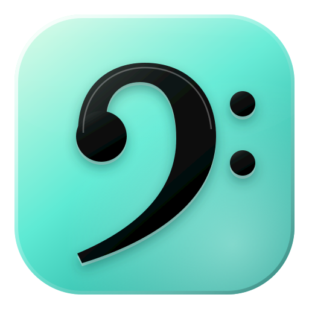

# falab



Aplicación de escritorio para **separar instrumentos, transcribir la letra, sacar los acordes y
editar la mezcla** de cualquier canción o video. Todo el análisis de IA se ejecuta **en tu equipo**:
no hay servidores ni coste por uso, y tu música no sale de tu ordenador.

- **Separación** en voz, bajo, batería, guitarra, piano y otros (Meta Demucs v4).
- **Anti-bleed** entre bajo y bombo.
- **Metrónomo dinámico** que sigue las fluctuaciones de tempo de la grabación (librosa).
- **Letra** con tiempos por palabra (Whisper) y **acordes** en cifrado estándar, jazz o latino
  (BasicPitch + análisis armónico).
- **Mini-DAW**: mezclador con faders, paneo, mute, solo y EQ paramétrico de 3 bandas; copiar,
  cortar y pegar; recorte arrastrando los bordes o con tiempos exactos; velocidad sin cambiar el
  tono y tono sin cambiar la velocidad; bucle; cuenta regresiva.
- **Vistas** Karaoke, Cancionero y Partitura.
- **Exportación**: mezcla o pistas en WAV/FLAC/MP3, video con la nueva mezcla, cancionero
  (PDF/TXT), partitura (MusicXML), MIDI y tablatura.
- **Biblioteca y playlists**: ficha de cada proyecto (peso, archivos, tempo, tonalidad), listas
  con orden manual, alfabético, por duración, BPM o tonalidad (cromática o círculo de quintas),
  panel lateral y botones de canción anterior/siguiente.
- **Directo**: show continuo (la canción siguiente empalma sin cortes), pedal MIDI o de teclado,
  tempo editable en BPM con un decimal, cuenta regresiva de 1–4 compases de 1–6 tiempos a negras o
  corcheas, marcadores de ensayo automáticos y editables, compás por sección y pista de guías de
  voz («Coro, dos, tres, cuatro»).
- **Proyectos portátiles**: exportar e importar un proyecto completo como archivo `.falab`.
- **Letra editable** y **detalle de acordes** ajustable para recuperar los acordes de paso.
- **Google Drive**: sincronización de proyectos en la carpeta `falab_projects`, manual o
  automática (con cola y reintentos si no hay conexión).

## Instalación en macOS (Apple Silicon)

Requisitos: [Homebrew](https://brew.sh) y las herramientas de Xcode (`xcode-select --install`).

```bash
git clone https://github.com/dennismcarrillo-ai/ProjectFalab.git
```

```bash
cd ProjectFalab && ./scripts/instalar_mac.sh
```

```bash
cd app && npm run tauri dev
```

Para generar la aplicación instalable (`.app` y `.dmg`):

```bash
cd app && npm run tauri build
```

La primera vez que analices una canción se descargan los pesos de los modelos; después todo
funciona sin conexión. Para conectar Google Drive, sigue [docs/GOOGLE_DRIVE.md](docs/GOOGLE_DRIVE.md).

### Probar la interfaz sin instalar los modelos

```bash
./scripts/instalar_mac.sh --sin-ia
```

En la pantalla de inicio, «Probar con una demostración» crea un proyecto con audio sintético.

### Desarrollo en el navegador (sin Tauri)

```bash
cd motor && .venv/bin/python -m falab_motor --puerto 8765
```

```bash
cd app && npm run dev
```

## Pruebas

```bash
cd motor && .venv/bin/python -m pytest
```

```bash
cd app && npm test
```

## Estado de la verificación

| Parte | Estado |
|---|---|
| Motor: anti-bleed, mapa de pulsos, acordes, exportaciones, biblioteca, API | Probado (25 pruebas automáticas) |
| Edición, EQ, reproductor y orden de playlists | Probado (35 pruebas automáticas) |
| Interfaz completa contra el motor | Probada en Chromium con el proyecto de demostración |
| Inferencia real de Demucs, BasicPitch y Whisper, y carcasa Tauri | Funcionando en una MacBook Pro M1 con canciones reales |
| Pedal MIDI y voz de las guías | La lógica está probada con mensajes y voz simulados; **pendiente de confirmar** con un pedal real y con la voz de macOS |
| Google Drive (subida, descarga y guardado automático) | La cola automática está probada con un Drive simulado; **pendiente de confirmar** contra Drive real |

## Limitaciones conocidas

- El stem de **piano** de `htdemucs_6s` es experimental en el propio Demucs y suele ser el menos limpio.
- Partitura y tablatura son transcripciones automáticas: sirven de punto de partida, no de edición final.
- El compás se detecta como 4/4; los cambios de compás se indican a mano por sección.
- Los nombres de las secciones (Verso, Coro…) son una propuesta automática: revísalos.
- En el show continuo, si alguna de las dos canciones usa cambio de velocidad o de tono, el empalme pierde unos milisegundos del final de la primera.
- Al exportar video, los cortes y movimientos de clips afectan al audio pero no a la imagen.
- La vista Partitura no aplica la transposición global (el cancionero y los acordes sí).

## Arquitectura

Ver [docs/ARQUITECTURA.md](docs/ARQUITECTURA.md): procesos, pipeline de IA y las decisiones que
mantienen bajo el consumo de memoria.

## Licencias de terceros

Demucs (MIT), BasicPitch (Apache 2.0), Whisper (MIT), librosa (ISC), SoundTouchJS (LGPL 2.1),
OpenSheetMusicDisplay (BSD), music21 (BSD). Rubber Band y FFmpeg se usan como programas externos.
